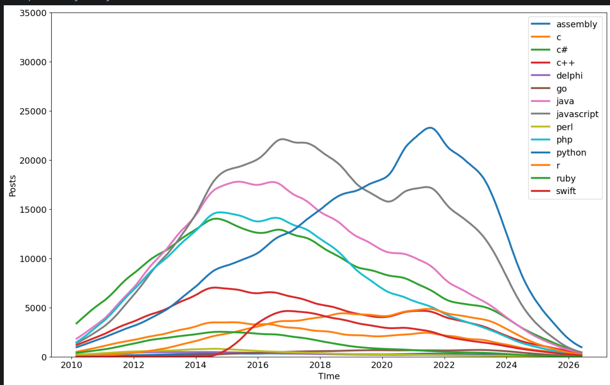
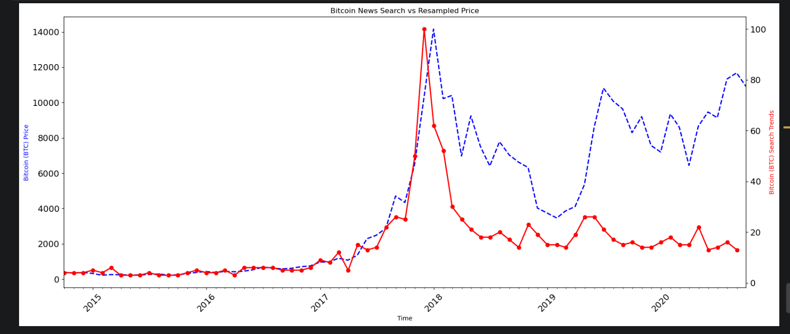
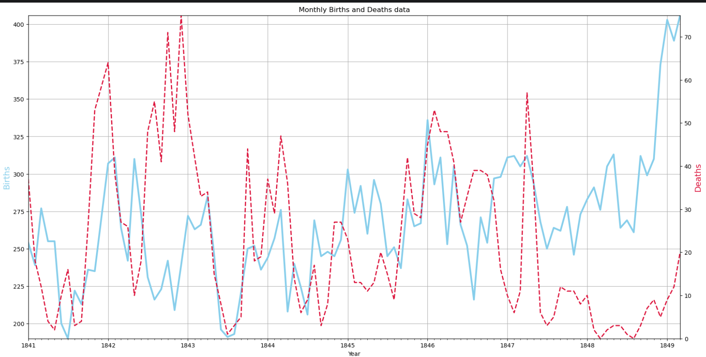
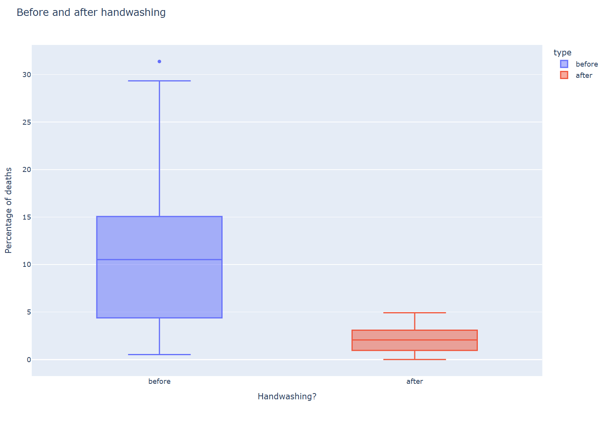
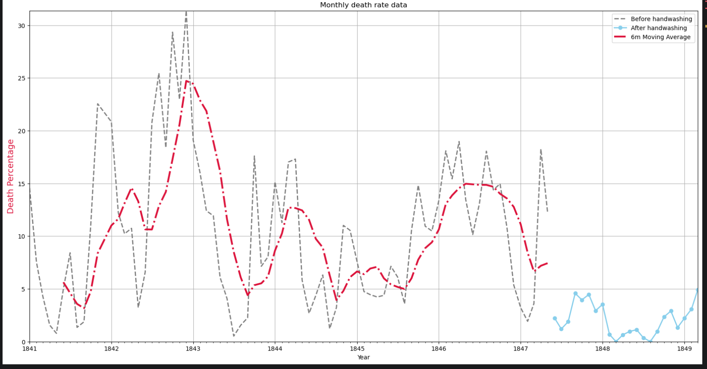
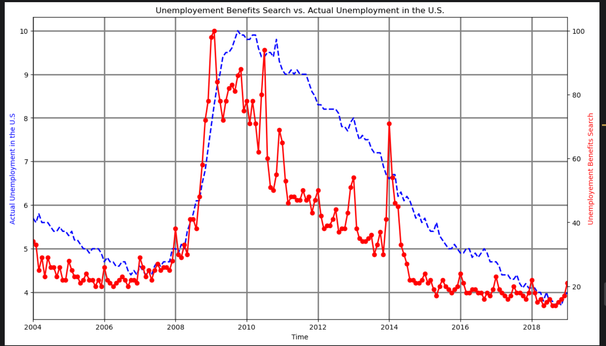
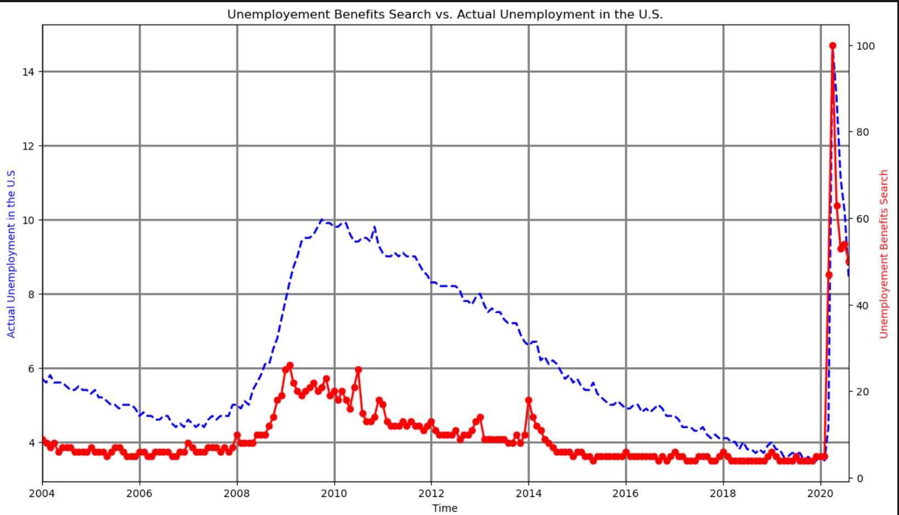

# Data Science — Days 72–81

A collection of data science projects covering pandas, visualisation, NumPy, statistics, and machine learning, built as part of a 100 Days of Code Python journey.

## 🖼️ Visual Insights & Key Findings

Below are key data visualizations generated across the analysis projects, highlighting main empirical findings, trend breakdowns, and statistical outcomes.

---

### 1. Programming Languages & Trends
| Visualization | Description & Key Findings |
| :--- | :--- |
|  | **Popularity Over Time:** Visualizes historical post counts and tag trends across programming languages using **Matplotlib**. Shows long-term growth trajectories and relative dominance of modern languages over time. |
|  | **Bitcoin Search vs. Price Trends:** Time-series alignment of Google search interest vs. historical asset behavior. Demonstrates strong correlation peaks between consumer search volume and price volatility. |

---

### 2. Historical & Medical Data Analysis (Semmelweis Handwashing Study)
| Visualization | Description & Key Findings |
| :--- | :--- |
|  | **Pre-Intervention Baseline:** Monthly tracking of clinic births vs. mortality rates before mandatory hand hygiene. Highlights severe, consistent spikes in post-birth mortality. |
|  | **Intervention Impact Analysis:** Step-change visualization showing the dramatic drop in mortality rates immediately following Dr. Semmelweis's handwashing protocol. Verified via Welch's **t-test** to confirm statistical significance ($p < 0.01$). |
|  | **Proportional Death Rates:** Comparative monthly analysis highlighting proportions of maternal deaths per clinic, clearly isolating historical systemic differences between wards. |

---

### 3. Economic Indicators & Time Series Analysis
| Visualization | Description & Key Findings |
| :--- | :--- |
|  | **Unemployment Benefits Search Trends:** Visualizing macro trends in online searches for unemployment benefits over multi-year cycles. |
|  | **Search Volume vs. Actual Unemployment Rate:** Overlay of Google Trends search metrics against official Bureau of Labor Statistics unemployment rates. Demonstrates how search engine query volume serves as an immediate leading indicator for real-world economic shocks, perfectly mirroring the sudden labor market disruptions caused by COVID-19 lockdowns. |
## 📂 Projects

| Day | Project | Topics Covered |
|-----|---------|-----------------|
| [72](./day72_collegemajors) | College Majors vs. Salary | Data exploration with Pandas |
| [73](./day73_matplotlib) | Programming Languages | Data visualisation with Matplotlib |
| [74](./Day74_lego) | Analysing the LEGO Dataset | Aggregating & merging data with Pandas |
| [75](./Day75_googletrends) | Google Trends Data | Resampling & visualising time series |
| [76](./day76_plotly) | Android App Store Analysis | Beautiful charts with Plotly |
| [77](./Day77_Numpy) | N-Dimensional Arrays | Computation with NumPy |
| [78](./Day78_sns) | Linear Regression | Data visualisation with Seaborn |
| [79](./Day79_novelprize) | Analysing the Nobel Prize | Plotly, Matplotlib & Seaborn |
| [80](./Day80_handwashing) | The Tragic Discovery of Handwashing | t-Tests & distributions |
| [81](./Day81_) | 🏆 Capstone Project | Predicting house prices |

## 🛠️ Tech Stack

- **Python 3**
- **Pandas** — data wrangling, aggregation & merging
- **NumPy** — numerical computation
- **Matplotlib / Seaborn / Plotly** — data visualisation
- **SciPy / Statsmodels** — statistical testing (t-tests, distributions)
- **Scikit-learn** — linear regression & predictive modeling
- **Jupyter Notebook**

## 📁 Structure

Each `dayXX_*` folder is self-contained and typically includes:
- A Jupyter notebook (`.ipynb`) with the analysis
- The dataset(s) used (CSV/Excel)
- Any generated charts or output files

## 🚀 Getting Started

```bash
git clone https://github.com/<your-username>/Data_Science.git
cd Data_Science
pip install -r requirements.txt
jupyter notebook
```

Then open the notebook inside the relevant `dayXX_*` folder.

## 📌 Notes

This repo is a running log of progress through the advanced data science section of a Python bootcamp — each project explores a different real-world dataset (salaries, LEGO sets, app stores, Nobel laureates, historical medical data, and housing prices) to practice a specific data science skill.

## 📄 License

This project is for personal learning purposes.